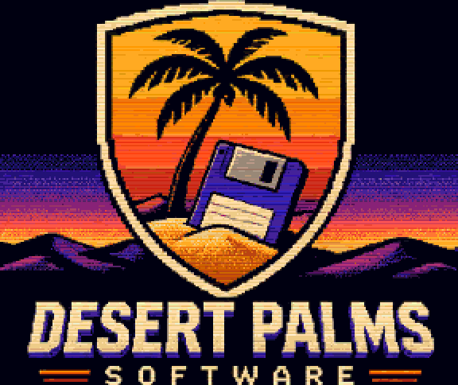
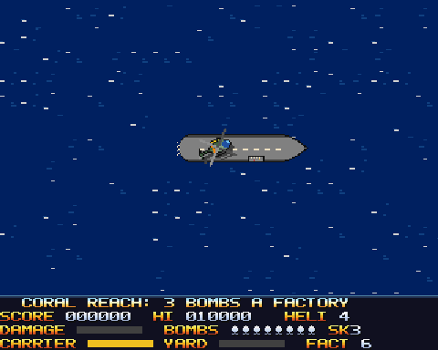

# ROTOR RAIDER

**An Amiga helicopter strike game, authored by Paul Ross Seibert and
published by Desert Palms Software.**

**© 2026 Desert Palms Software.**

<p align="center"></p>

<p align="center"></p>

<p align="center"><b><a href="demo/rotor-raider.mp4">▶ Watch the gameplay video (with sound)</a></b></p>

The Iron Combine has turned three island chains into war-factory theatres.
Fly the gunship *Kestrel* off the carrier DPS *Mirage*, which steams a slow
patrol across each theatre, and bomb the six factories before the Combine
overwhelms you. Its sandbagged AA guns turn to track you and throw flak, and
homing missiles once half the factories are down. Radar stations send interceptors after you. Bombers go
for your carrier. Supply boats rebuild damaged factories. In the shipyard a
cruiser is being built, and when it sails it hunts the carrier.

Three theatres, each harder than the last: **Coral Reach** (a factory
takes 3 bombs), **Ember Flats** (4, with quicker flak, more planes and a
faster-built cruiser) and **Frostline** (5, and missiles almost at once).

## Download

| File | What it is |
|---|---|
| [**rotor-raider.adf**](https://github.com/PaulSeibert/rotor-raider/releases/latest/download/rotor-raider.adf) | The game disk: a bootable Amiga floppy image. This is all you need to play. |
| [rotor-raider-1.3.zip](https://github.com/PaulSeibert/rotor-raider/releases/latest/download/rotor-raider-1.3.zip) | The full release: the disk, the program for hard-disk installs, a README, the music credits and the demo GIF |
| [rotor-raider-demo.mp4](https://github.com/PaulSeibert/rotor-raider/releases/latest/download/rotor-raider-demo.mp4) | The gameplay video |

All versions are on the [Releases page](https://github.com/PaulSeibert/rotor-raider/releases).

**New in 1.4:**
- every AA gun warns before it fires: its barrels hold still and glow red, then flash;
- flak flies at half the speed (1.5 px a frame): keep moving and it bursts behind you;
- the music in the air keeps all four voices (the rotor used to take one all game);
- sound effects in stereo, on the side of the screen where they happen;
- the cruiser is a proper fight: its strength on the HUD, and ignored it closes in, then launches jets; sinking it repairs the carrier;
- Ember Flats and Frostline press harder than before (more flak, earlier jets);
- the title music plays on all four channels.

**New in 1.3:**
- a new title logo;
- music by Songerson on Amigas with 1 MB of chip RAM or more, with a credits page on the title;
- classic steering now backs off tail first when you hold down after stopping (let go to hover);
- the title logo no longer flickers after a game over;
- AA guns no longer turn into grey blobs when two of them share the same lines on screen.

**Requirements:** an Amiga 500 with **1 MB of RAM** (512K chip + 512K
expansion), Kickstart 1.3 or later, PAL. It runs at 50 frames a second on a
stock 7 MHz 68000 with the original OCS chips. It's tested on Kickstart 1.3,
Kickstart 3.1 and the free AROS Kickstart replacement.

## Playing it

The ADF boots by itself, just like putting the floppy in a real Amiga.

- **WinUAE** (Windows) or **FS-UAE** (Windows, macOS, Linux): an Amiga 500
  configuration with 512K chip + 512K slow RAM and PAL, `rotor-raider.adf`
  in drive DF0:. Without a Kickstart ROM, both emulators can use their
  built-in AROS ROM, which the game runs on. Kickstart ROMs are sold by
  Cloanto in Amiga Forever.
- **THEA500 Mini:** copy `rotor-raider.adf` to a FAT32 USB stick and pick it
  from the USB menu. Choose the A500 setup and PAL if it asks.
- **Amiberry** (Raspberry Pi and others): an A500 configuration, with the
  ADF in DF0:.
- **A real Amiga:** write the ADF to a floppy (with a Greaseweazle, or
  ADF-Copy), or copy it to a Gotek drive.

In an emulator, map your joystick or gamepad to port 2. Or play on the
keyboard: arrow keys, Space and B.

## Controls

Choose the steering on the title screen with left/right.

| Input | Classic steering | Arcade steering |
|---|---|---|
| Stick | Left/right turn the gunship, up flies forward, down slows to a stop, then backs off tail first (let go to hover) | Push where you want to go: it turns that way and flies |
| Feel | **Momentum**: off the stick the gunship glides on for a couple of seconds, and turning swings the nose (and the gun) without changing where you're going: slide past a target strafing it, or turn under thrust in a wide arc | Snappy: it stops when you let go |
| Fire | The chin gun (it strikes the ground ahead, and hits planes) | same |
| Hold fire (0.3 s) | Drop a bomb | same |
| Second button (or B) | Drop a bomb at once; then holding fire fires the gun continuously | same |

Keys: arrows, Space = fire, B = bomb, P = pause, M = music on/off, Esc = quit.

**Bombs** fall ahead of you in an arc: the blinking marker on the ground
shows where. You carry 8. **Land** on the carrier's deck (or the friendly
airstrip's helipad) by hovering slow and still over it: the gunship sets
down, rides with the ship, repairs and reloads. Any push takes off again.

**Finding the carrier:** when it's off screen, a yellow arrow at the edge of
the play area points to it (it blinks when you're out of bombs or badly
damaged), and the arrow after CARRIER on the HUD shows its direction too.
Once the carrier is sunk, both point to the airstrip.

## Difficulty

Press **Ctrl+L**, then a number key within two seconds. The setting shows on
the score bar (SK3) and stays until you change it.

| Key | Setting |
|---|---|
| 1 | Easiest: slower, less accurate flak, fewer and later planes |
| 2 | Easy |
| 3 | **Normal** (the default) |
| 4 | Hard |
| 5 | Hardest |
| 0 | **GODMODE**: nothing can destroy the gunship (hits still show). For testing; it doesn't set the hi-score. In GODMODE, **Ctrl+L then 9** jumps to the next standing factory. |

## How to play

- A factory takes three bombs. The gun doesn't hurt it, but it does destroy
  AA turrets and radar stations, and sinks supply boats.
- A damaged factory slowly repairs itself, and every supply boat that reaches
  its pier repairs it more. Sink the boats, finish what you start.
- Destroy the radar stations and the interceptors stop finding you.
- Bomb the shipyard to set the cruiser back. If it sails, sink it (it takes
  five bombs) before it sinks the carrier: the HUD's YARD bar becomes ENEMY,
  the cruiser's strength in red. Leave it alone for 45 s and it closes in
  twice as fast, firing twice as often; for 90 s and it launches a jet at you
  every 20 s (each hit on it restarts the clock). Sinking it is worth 3000
  points and repairs the carrier.
- If the carrier sinks, the airstrip is your only place to land.
- Damage shows on the HUD bar; at 100% the gunship goes down. You have four.
- An AA gun's barrels show where it's aiming. Before every round they hold
  still and glow red for about a third of a second (16 frames on normal,
  longer on the easier settings): that's your warning. Then they flash and
  fire.
- The HUD shows the score, gunships left, damage, bombs, the carrier's
  strength, the shipyard's progress, factories left and a map of the whole
  theatre (red: factories, yellow: the carrier, white: you, orange: planes).

## What the Amiga is doing

- **Two playfields.** The terrain is an 8-way scrolling playfield of 16×16
  tiles: a ring of bitplane memory where moving the camera only moves the
  start pointer (rows wrap into each other horizontally, and the copper
  points the planes back at the ring's start where the picture reaches its
  end). New tiles are blitted into the margin before they come into view.
  Everything else (the carrier, planes, ships, flak, bombs, explosions, the
  shadow) is drawn by the blitter on the second playfield, so nothing has to
  restore the terrain.
- **The AA guns** are hardware sprites: two attached pairs of 15 colours,
  each reused down the screen, so a dozen guns turning to track you cost the
  blitter and the CPU almost nothing. (A gun the sprites have no room for on
  its lines is drawn by the blitter instead.)
- **The title logo.** The ROTOR RAIDER logo (the rotor in its orange swirl
  over ROTOR in orange-gold and RAIDER in blue) is a 160×146 picture in the
  objects' playfield, with the theatre panning behind it and showing through
  round it. That playfield has only 7 colours, so the copper reloads all 7 on
  every one of the logo's 146 lines, the 7 that line needs most: 319 colours
  in one 3-plane picture. Its block of copper commands is written once.
- **The copper.** Each band of islands has its own eight colours, loaded
  where the band starts on screen, always in open sea, so the changes never
  show: about three times the colours on screen. The wave crests glitter,
  dusk falls over the theatre as the battle goes on, and the HUD is a
  separate screen under the play area. Its lettering is the game's own bold
  font, and the copper colours it row by row: the labels like hot metal, the
  numbers white to steel, the messages ice to gold.
- **Sprites.** The gunship is a 32×32, 15-colour attached hardware sprite in
  16 headings with a turning rotor, its shadow on the ground showing its
  height.
- **The Desert Palms Software logo** at boot: 16 colours with 4 reloaded on
  every line, about 320 colours in one picture, faded in and out by the
  copper.
- **Paula.** A looped rotor chop pitched by your speed, sound effects in
  stereo on the side of the screen they happen on, a sampled march on the
  title (the channel policy is below).
- **Music on machines with 1 MB of chip RAM or more** (A500+, A600, A1200):
  two ProTracker modules by Songerson, *dog68* on the title and *dog70* in the
  air, kept on the floppy and loaded into chip RAM at boot when there's room.
  The title then shows a credits page. A 512 KB A500 plays the original title
  march.
- **The floppy.** The three theatres, the logos and all the blitter objects
  are packed on the disk and loaded when needed, so the program stays small
  enough for a 1 MB A500.

## Sound: who gets Paula's four channels

Paula plays channels 0 and 3 on the left, 1 and 2 on the right.

| Channel | Side | In the air | On the title and jingles |
|---|---|---|---|
| 0 | left | the rotor while it has the channel, otherwise music | music |
| 1 | right | music; effects on the right of the screen | music; menu effects |
| 2 | right | music | music |
| 3 | left | music; effects on the left of the screen | music; menu effects |

- **Effects** (`sound/sound.toml`, `sfx_channels = [1, 3]`) play on the side
  of the screen where they happen: flak, missiles, explosions and factories
  by their position, the gunship's own sounds by where it is. Within 40 px of
  the middle they take whichever of the two is free. The cruiser's klaxon
  comes from anywhere. An effect takes its channel from the music for its
  length (0.08-0.5 s); those are the bass and drum voices, which come back at
  their next note.
- **The rotor** borrows channel 0. In the air the music is Songerson's
  *dog70*, whose voice 0 (string chords) is silent for its first 61 s, after
  which the song loops on all four voices. So the rotor loops on channel 0
  while there's no music in the air (a 512 KB A500, or music off with M) and
  for *dog70*'s first 59 s; then it fades out and gives the channel back, and
  from there it's a short fading chop at take-off and landing, on the effect
  channel of the gunship's side. Before 1.4 the rotor kept channel 2 all game,
  and *dog70* lost its voice 2, the analog string pad: its loudest voice,
  sounding 86% of the song (`python3 sound/tools/mod_voices.py
  sound/songerson_-_dog70.mod` measures it). The module itself is unchanged.

## Pacing

Measured with `tools/pacing.agk` (all three theatres flown the same scripted
way in GODMODE: per factory, 12 s weaving and shooting round it, its bombs,
6 s flying off; about 2.5 minutes a theatre) and `tools/pace.py`, which reads
what the game prints every 16 frames: planes and enemy shots (flak, missiles)
on screen, and shots fired at the gunship. Threat = planes + shots on screen.
Version 1.4, normal difficulty, A500:

| Theatre | threat mean | p90 / max | nothing to dodge | shots on screen mean / p90 | shots fired a minute | rest beats (3 s+ quiet) |
|---|---|---|---|---|---|---|
| Coral Reach | 0.64 | 2 / 4 | 65% | 0.56 / 2 | 30 | 12 in 2.3 min |
| Ember Flats | 1.02 | 3 / 6 | 48% | 0.92 / 3 | 46 | 10 in 2.4 min |
| Frostline | 1.35 | 4 / 8 | 45% | 1.21 / 4 | 67 | 9 in 2.6 min |
| *playbook target* | *2.5-3, +50% a level* | *6 / 10-12* | *8-12%* | *0.7-1.5 / 2.5-5* | *30-100* | *a 4-8 s rest every 60-80 s* |

- Shots on screen and shots fired a minute are in the playbook's bands. The
  threat mean is well under the vertical shooters' 2.5-3, and the quiet share
  far over: this is an open map where the player picks the fight, so the
  flights between targets are quiet by design; at a factory the turrets put
  2-4 threats up. Not tuned.
- The step between theatres was +23% and +21% (shots fired 30 / 38 / 48 a
  minute) against the playbook's +50% a level. 1.4 sharpens it: the turrets'
  cooldown is 35 and 60 frames shorter in Ember Flats and Frostline (was 15
  and 30) and the jets come 300 and 500 frames sooner (was 250 and 450). Now
  +59% and +32% threat, +53% and +46% shots fired.
- The scripted run is quicker than a player, so it rarely reaches the
  2-minute alert steps or the cruiser, which add to these numbers later in
  a theatre. Landing on the carrier stays a rest beat: a gun never fires at
  a gunship on deck.

## Building

The game is written in C, with the Amiga Game Kit (`agk`) and the
[ACE](https://github.com/AmigaPorts/ACE) engine. `src/logic.c` holds the game
rules and `src/enemies.c` the enemy's (portable C, unit-tested on a PC),
`src/theatre.c` reads a theatre, `src/scroll.c` is the scroller, `src/main.c`
the rest of the Amiga side, and `src/splash.c` the logo screen.

```sh
agk unit      # game rules on the host (tests/unit)
agk build     # build/rotorraider.adf, a bootable floppy
agk test      # emulator tests on A500 (KS 1.3, KS 3.1, AROS)
agk release && python3 tools/finish_release.py   # the zip for Aminet / itch.io (build/release/)
agk record demo/showcase.agk -o build/demo.mp4 --readme --gif demo/rotor-raider.gif --gif-start 8.5 --gif-seconds 12
cp build/demo.mp4 demo/rotor-raider.mp4
```

Everything is made by scripts, so every asset can be regenerated from source:
`art/tools/tiles.py` (the terrain tiles), `art/tools/theatres.py` (the three
theatres: islands from a seed, structures placed by rules), `art/tools/sprites.py`
(the gunship, the AA guns and everything else that moves, rendered from simple
models at every heading), `art/tools/hudfont.py` (the font),
`art/tools/make_dps_logo.py` (the Desert Palms Software logo),
`art/tools/make_title_logo.py` (the title logo, from
`art/src/rotor_raider_title_source.png`; run it before `sprites.py`, which
packs it with the other blitter objects) and `sound/tools/make_samples.py`
(the instruments).

## Credits

**Rotor Raider** is authored by **Paul Ross Seibert** and published by
**Desert Palms Software**. © 2026 Desert Palms Software. All rights reserved.

Design, code, graphics and the title march: Paul Ross Seibert.

Music on 1 MB-chip machines: *dog68* and *dog70* by **Songerson**, from
[The Mod Archive](https://modarchive.org), licensed
[CC BY](https://creativecommons.org/licenses/), used unchanged
(`sound/songerson_-_dog68.mod`, `sound/songerson_-_dog70.mod`; the release
zip's `CREDITS.txt`).
An original game, inspired by the helicopter strike games of the 1980s.

Built with:
- the [ACE](https://github.com/AmigaPorts/ACE) game engine, including its
  ProTracker player (Mozilla Public License 2.0)
- the Amiga Game Kit runtime (MIT License)
